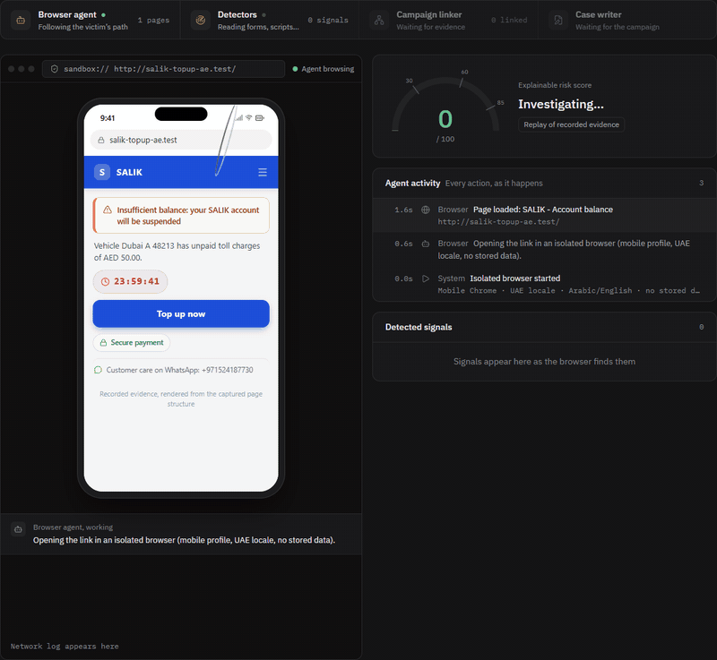
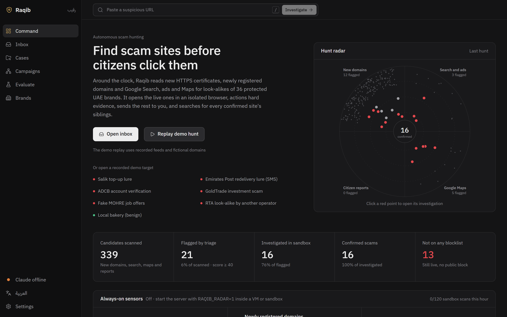
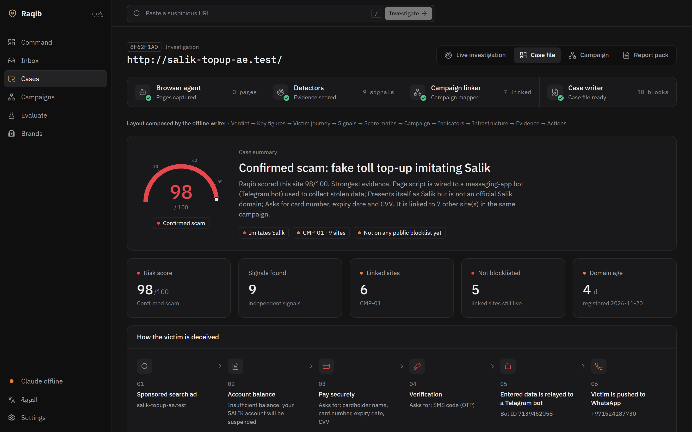
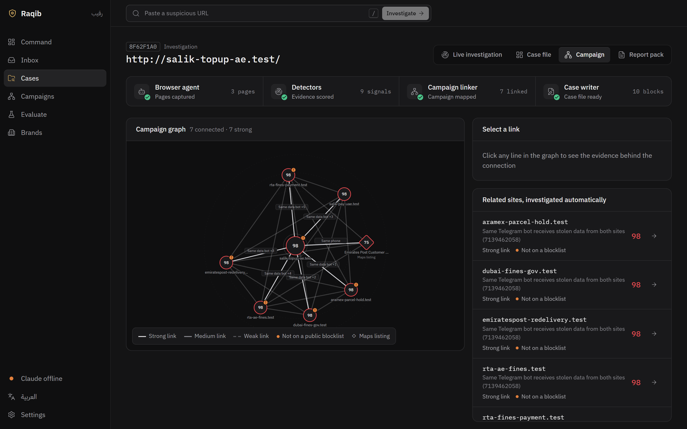
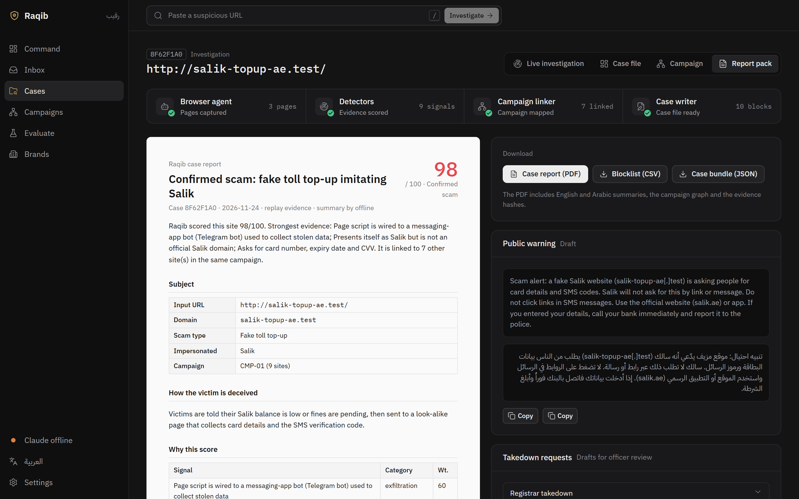
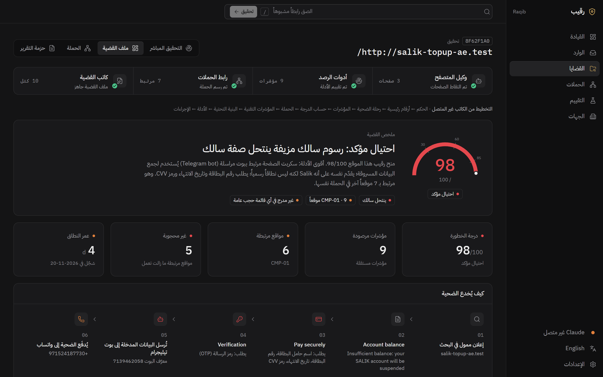

<p align="center">
  
</p>

<p align="center">
  <b>SCAMSHIELD AI Hackathon</b> · 42 Abu Dhabi × Abu Dhabi Police<br>
  <sub>Challenge: detect fraudulent links and websites used in cybercrime and financial fraud, including in search results and Maps</sub>
</p>

<p align="center">
  <a href="https://raqib-ygz3.onrender.com">Live demo</a> ·
  <a href="#how-it-works">How it works</a> ·
  <a href="#accuracy">Accuracy</a> ·
  <a href="#safety">Safety</a> ·
  <a href="#run-it">Run it</a> ·
  <a href="#route-to-a-police-pilot">Pilot</a> ·
  <a href="#honest-limits">Limits</a>
</p>

<br>

**Most scam sites are discovered by their victims. Raqib finds them first.**

**Live demo:** [raqib-ygz3.onrender.com](https://raqib-ygz3.onrender.com) (recorded demo cases; the free server may take a minute to wake up).

Fake RTA fines, Salik top-ups, Emirates Post parcel fees and bank "account restricted" pages reach UAE residents through SMS links, sponsored search ads and fake Google Maps helplines. Today each one is handled after someone reports it, and the operator simply moves the same kit to a fresh domain.

Raqib (رقيب, "the watchful one") is an investigation desk for police analysts. It watches where scam sites appear, opens the suspicious ones in a sealed phone browser, explains every point of its risk score, links each site to the rest of its operator's network, and prepares the evidence and takedown drafts. An officer approves every action.

<p align="center">
  
  <br>
  <sub>A recorded demo case, replayed. The agent inspects every card and OTP field and types nothing.</sub>
</p>

<br>

## How it works

| | Step | What Raqib does |
|---|---|---|
| 01 | **Watch** | Reads new HTTPS certificates from public Certificate Transparency logs within minutes of issue, the daily list of about 70,000 newly registered domains, Google Search, ads and Maps, and citizen or hotline reports. |
| 02 | **Triage** | Cheap checks with no browser: look-alikes of 36 protected UAE brands and 17 global ones (homoglyphs, brand plus lure words, a brand hidden in a sub-domain), domain age, abused TLDs, odd Maps listings. |
| 03 | **Investigate** | Opens only the suspects in an isolated, throwaway phone browser with a UAE locale. Follows every redirect, expands short links, compares what phones and computers are shown, and captures the screenshot, page, forms, scripts and network log. Nothing is typed, submitted or downloaded. |
| 04 | **Explain** | 32 deterministic rules, plus an optional vision check, turn the evidence into a 0 to 100 score. Every point carries a reason in English and Arabic. |
| 05 | **Link** | Fingerprints each site (scam-kit hashes, Telegram bot and Discord webhook IDs, crypto wallets, phone and WhatsApp numbers, favicon, analytics IDs, redirectors, registration batch, visual similarity) and links it to known campaigns with a graded strength. Looking alike is never treated as proof of the same operator. |
| 06 | **Act** | SHA-256 chain of custody, a bilingual PDF case report, takedown drafts for the registrar, host, Google Safe Browsing and Google Maps, a blocklist feed and a public warning. |

<p align="center">
  
  <br>
  <sub>Command: a replayed hunt of the demo dataset. 339 candidates, 21 flagged, 16 confirmed, 13 still live and not on any public blocklist.</sub>
</p>

### The radar: nobody has to paste a link

With `RAQIB_RADAR=1` the radar ([`radar.py`](backend/raqib/radar.py)) runs on its own from server start. It is off by default because it opens real suspicious sites, so turn it on only inside the [sandbox VM](#safety).

1. **Watch.** Certificate logs continuously (the newest entries, within a bandwidth budget, with the share read shown on screen), the new-domain list every 6 hours, and one Search, ads or Maps query at a time inside the SerpAPI monthly budget.
2. **Triage.** Only look-alikes of protected brands go further. Official, vetted-zone and trusted domains are skipped.
3. **Probe, then scan.** One quick HTTP request first. Pages that are online and not parked get a full sandbox investigation and case file.
4. **Watchlist.** Domains that are not live yet, parked, or empty so far are checked again after 1 hour, 6 hours, 24 hours, 3 days and 7 days.
5. **Siblings.** Every confirmed site starts a search for related ones: a shared kit, bot, wallet or phone, the same naming pattern among new domains, or the same server.
6. **Act in tiers.** Hard evidence (score of 85 or more, a named brand, and a card, OTP, password or ID form or a data-stealing bot) goes on the blocklist feed (`/api/radar/blocklist.txt`) with Safe Browsing and brand reports drafted. Everything else, and every registrar or host takedown, waits in the **Inbox** for an analyst. Nothing is sent. Confirmed sites are rechecked daily until they go offline.

The Inbox has a pause switch, an "everything to me" switch for automatic actions, and an audit log of every step.

### The case file

<table>
  <tr>
    <td width="50%"></td>
    <td width="50%"></td>
  </tr>
  <tr>
    <td><sub><b>Case file.</b> The verdict, the figures behind it and how the victim is deceived, step by step.</sub></td>
    <td><sub><b>Campaign.</b> One Telegram bot ties toll, fine and parcel scams to one operator. Click any link to see its evidence.</sub></td>
  </tr>
  <tr>
    <td width="50%"></td>
    <td width="50%"></td>
  </tr>
  <tr>
    <td><sub><b>Report pack.</b> PDF, blocklist and case bundle, a public warning in both languages, and takedown drafts for officer review.</sub></td>
    <td><sub><b>Arabic.</b> The interface, case files and reports are fully bilingual, with the layout mirrored.</sub></td>
  </tr>
</table>

### Where AI is used, and where it is not

Raqib uses Anthropic **Claude Sonnet 5.5** (`claude-sonnet-5-5`, set with `RAQIB_MODEL`) for four things:

- writing the case summary and **choosing the case-file layout** as structured output (which of 14 block types to show, in what order, with what wording)
- answering an analyst's follow-up questions with blocks of its own
- checking screenshots for visual impersonation of any brand
- optionally driving the live browser agent through the victim's path, with guardrails enforced in code

**Scores and verdicts always come from the deterministic pipeline, so the model cannot invent a number.** Without an API key an offline writer produces the same case-file shapes, and the interface says which one wrote each case.

<br>

## Accuracy

Measured on 24 November 2026 inside the locked-down sandbox VM, with deterministic rules only and no Claude: 40 live phishing URLs from the OpenPhish feed, 40 ordinary websites from the Tranco list, and 20 official UAE sites. Full results, a threshold sweep, every mistake and its screenshot are in [`docs/eval/results.md`](docs/eval/results.md).

| | Result | 95% interval |
|---|---|---|
| Ordinary websites wrongly flagged | **0 of 40** | 0–9% |
| Official UAE sites wrongly flagged | **0 of 20** | 0–16% |
| Flagged URLs that were real scams (precision) | 3 of 3 | 44–100% |
| Phishing URLs caught (recall) | 3 of 40, 8% | 3–20% |
| Median time per URL | 10.9 seconds | |

Raqib is tuned for trust first: a wrongful takedown hurts a real business, so it raised no false alarms across 60 real sites. Recall on this feed is low because almost all of it targets global brands from free hosting (`pages.dev`, `github.io`, `netlify`) with cloaked or script-loaded kits, while Raqib's rules are built around UAE brands and visible forms. The vision check, which can now name any brand, was not part of this run, and the rules for disguised pages on free hosting were added after it, so they are not reflected in these numbers yet.

Reviewing the 37 misses showed that most were pages Cloudflare had already replaced with its own "Suspected Phishing" warning, which Raqib did not read as evidence. Three fixes followed: the hosting provider's phishing / malware warning page now counts as strong evidence; sensitive form labels disguised with look-alike letters ("Pàsswørd") are recognised and flagged; and a bank or crypto-wallet brand named on free hosting or a brand-new domain is no longer discounted. After the fixes, 0 of 35 real sites (the 20 official UAE sites plus global login pages such as PayPal, Microsoft and Binance) scored 30 or more. A re-run on a fresh phishing sample inside the sandbox VM will replace the numbers above.

Run the same evaluation on any labelled list:

```powershell
cd backend
.venv\Scripts\python -m raqib.cli urls.txt --out results.csv                         # one URL per line
.venv\Scripts\python -m raqib.cli test.csv --out results.csv --json results.json    # url,label: precision, recall, F1
.venv\Scripts\python -m raqib.cli urls.txt --no-browser                              # faster HTTP-only mode
```

To repeat the sandbox run: `tools\eval_sets.py` builds the lists (it opens none of the URLs), `deploy/vm/run-eval.sh` scans them inside the VM, and `tools\metrics_report.py` writes the report with defanged links.

A URL counts as fraud at a score of 60 or more (`--threshold` changes it). The same evaluation runs in the dashboard under **Evaluate**.

<br>

## Safety

Opening real scam pages is the risky part, so it happens in layers.

**The agent never types.** On card, OTP, ID and password fields it inspects and moves on. This is enforced in code and covered by a test that drives the browser executor against a local page with a scripted stand-in for Claude.

**The sandbox VM** ([`deploy/vm/`](deploy/vm)) is where the accuracy numbers were measured. It passed 20 of 20 isolation checks plus 2 host backstop checks ([`sandbox-checks.txt`](docs/eval/sandbox-checks.txt)).

| Layer | What it does |
|---|---|
| VM | No shared folders, clipboard, drag and drop, USB, audio or Guest Additions. One virtio NAT adapter (the emulated default froze under load), and the VM cannot reach the host's own services. SSH and the dashboard are forwarded to the host's 127.0.0.1 only. |
| Host firewall | The VirtualBox processes may not connect to private networks, even if the guest is compromised. |
| Guest firewall | Outbound only TCP 80 and 443 to public addresses, plus DNS and NTP. Private, link-local, carrier-NAT, cloud-metadata and IPv6 traffic is dropped, which also defeats redirects, WebSockets, WebRTC and DNS rebinding. |
| Browser | Chrome's own sandbox on, a fresh browser process per site, no secrets in its environment, an unprivileged user under systemd limits. |
| Secrets | No API key ever enters the VM. Verdicts come from the deterministic rules. |
| Reset | The `clean-hardened` snapshot is restored after every run. |

Rebuild it on Windows with VirtualBox 7.2: `deploy\vm\create-vm.ps1 -Iso <ubuntu-server.iso>`, then `host-firewall.ps1` as administrator, then `deploy.ps1 -User <admin> -Step harden`, `-Step app` and `-Step checks`.

For production, the design is one gVisor or Firecracker micro-VM per site, with a broker outside the sandbox holding the keys.

**The container** (`docker compose -f docker/docker-compose.yml up --build`) is a lighter option: loopback-only port, no host folders, all Linux capabilities dropped, read-only root filesystem, and memory, CPU and process caps.

<br>

## Run it

You need Python 3.11 or newer, Node 20 or newer, and Google Chrome (or `playwright install chromium`).

```powershell
# backend
cd backend
python -m venv .venv                              # or: uv venv .venv --python 3.11
.venv\Scripts\pip install -r requirements.txt
.venv\Scripts\python tools\build_seed.py          # regenerate the demo dataset

# dashboard
cd ..\frontend
npm install
npm run build

# API and dashboard on http://127.0.0.1:8600
cd ..\backend
.venv\Scripts\python -m uvicorn raqib.main:app --port 8600
```

On macOS and Linux use `.venv/bin/...` instead of `.venv\Scripts\...`. For frontend work, `npm run dev` in `frontend/` serves on port 5173 and proxies `/api`.

Optional settings go in a `.env` file at the repository root (see [`.env.example`](.env.example)). The API key can also be pasted in the app's Settings. `.env` is git-ignored, the sandbox VM never receives a key, and the public demo runs without one.

```ini
ANTHROPIC_API_KEY=sk-ant-...     # Claude features
RAQIB_MODEL=claude-sonnet-5-5
SERPAPI_KEY=...                  # live Google Search, ads and Maps
SERPAPI_MONTHLY_BUDGET=250       # searches the radar may use per month (free plan: 250)
RAQIB_MODE=live                  # let the Claude browser agent drive unknown URLs
RAQIB_BROWSER_CHANNEL=chrome     # use installed Chrome if Playwright's Chromium is missing
RAQIB_RADAR=1                    # the autonomous radar (only inside the sandbox VM)
RAQIB_CHROME_SANDBOX=1           # Chrome's own sandbox (Linux, non-root); no fallback without it
RAQIB_FRESH_BROWSER=1            # a new browser process for every page
RAQIB_RADAR_AI=0                 # 1 lets Claude write radar case files (costs tokens per scan)
RAQIB_CT_TILES_PER_MIN=2         # certificate-log tiles read per minute per log (~0.5 MB each)
```

**Public demo link.** `RAQIB_PUBLIC_DEMO=1` serves recorded cases only, with settings and radar changes switched off. [`render.yaml`](render.yaml) deploys exactly that. Real scanning stays in the sandbox VM.

**Tests.** `cd backend` then `.venv\Scripts\python -m pytest` runs 31 tests: detectors on every recorded case, false-positive rules (news articles that mention a brand, old domains, trusted and vetted zones), URL tricks (short links, IP hosts, punycode, `@`, a brand in a sub-domain, free hosting), cloaking, campaign linking, triage, batch metrics, the radar, public demo mode, Chrome launch settings (sandbox on, no secrets passed), dead look-alike links, and the browser executor that must never type into a sensitive field.

### Using the dashboard

| Page | What it shows |
|---|---|
| **Command** | The hunt radar, the detection funnel, the always-on sensors, flagged candidates, active campaigns and a world map of hosting infrastructure |
| **Inbox** | What the radar found that needs an analyst: approve, reject, pause, audit log |
| **Cases** | Every investigation, newest first. Paste any URL in the top bar (or press `/`) to investigate it live (the public demo opens recorded cases only). |
| **Case file** | The layout chosen for each case, with follow-up questions |
| **Campaigns** | Linked sites and the evidence behind every link |
| **Evaluate** | Batch scans with precision, recall and a confusion matrix |
| **Brands** | The protected registry and each brand's official domains |

### Data sources

| Source | Used for | Key |
|---|---|---|
| Certificate Transparency logs (public tiled logs) | the earliest public sign of a new HTTPS site | no |
| [WhoisDS](https://www.whoisds.com/newly-registered-domains) newly registered domains | the daily new-domain hunt | no |
| [RDAP](https://rdap.org) | registration date, registrar, name servers, IP owner | no |
| [SerpAPI](https://serpapi.com) Google and Google Maps engines | live Search results, sponsored ads and Maps listings | `SERPAPI_KEY` |
| [OpenPhish](https://openphish.com) community feed | live phishing samples for evaluation | no |
| [Tranco](https://tranco-list.eu) research top-1M list | ordinary websites for the false-positive test | no |
| [HackerTarget](https://hackertarget.com) reverse IP | sibling search: other domains on the same server (20 lookups a day) | no |
| Anthropic Messages API | summaries, case-file layout, vision check, browser agent | `ANTHROPIC_API_KEY` |

Bundled data lives in [`backend/raqib/data/`](backend/raqib/data): `registry.json` (53 protected brands with official domains, English and Arabic names and keywords), `trusted_domains.txt`, and the **fictional** demo dataset in `cases/` and `feeds/`. The demo uses reserved `.test` domains, documentation IP ranges and made-up numbers, so the whole flow can be shown safely and offline.

<br>

## Route to a police pilot

1. **Pilot, 4 weeks.** Run on Abu Dhabi Police servers inside the sandbox. Ingest citizen SMS reports, certificate logs and the new-domain feed. Analysts review every case, and precision is measured on real reports.
2. **Expand.** Search and Maps feeds, a takedown workflow with registrars, hosts and Google, a shared blocklist with TDRA and ISPs, and legal-request templates for telecoms, exchanges and messaging platforms.
3. **Scale.** Scan workers behind a queue, one micro-VM per site, national rollout, and accuracy reported on every release.

## Honest limits

- **Recall on global phishing is low** (3 of 40 in the latest run). Raqib is built for UAE brands and visible forms, and was tuned to raise no false alarms first.
- **The demo dataset is fictional** and recorded for safety. Real URLs are scanned live by the scanner, and real accuracy is in [`docs/eval/results.md`](docs/eval/results.md).
- **Live Search and Maps data needs a SerpAPI key.** Without one, the recorded feed is used. Certificate logs and the new-domain list are live and free.
- **The public demo runs on a free server** that sleeps after 15 idle minutes; the first visit then takes about a minute.
- **A hosting country is an infrastructure clue,** never the location of the people behind a scam.
- **Pages that only show the scam after interaction** are best covered by the Claude browser agent in live mode, which has been tested against a local page with a scripted model but not yet against the real API.
- **Raqib is decision support.** Officers review every case, and nothing is sent on its own.

<br>

<details>
<summary><b>Repository layout</b></summary>

```
backend/raqib/     scanner.py        the URL scanner          detectors.py    signals and score
                   campaign.py       campaign linking         radar.py + ct.py  the autonomous radar
                   hunters*.py       discovery and triage     investigations.py  orchestration
                   batch.py, cli.py  evaluation               live.py         Claude browser agent
                   claude_service.py, ui_spec.py  case-file writer and layout
                   report.py         PDF and takedown drafts  main.py         the API
backend/tests/     pytest suite
backend/tools/     build_seed.py (fictional demo data), eval_sets.py and metrics_report.py (accuracy runs)
frontend/src/      views (Command, Inbox, Cases, Investigation, Campaigns, Evaluate, Brands) and components
deploy/vm/         the sandbox VM: build, harden, checks, evaluation
docker/            the hardened container
render.yaml        the public demo deployment
docs/eval/         accuracy results and sandbox proof     docs/readme/  these images
```

</details>

<sub>Team: `[TEAM NAME]` · `[MEMBER 1]`, `[MEMBER 2]`, `[MEMBER 3]`, `[MEMBER 4]`</sub>
